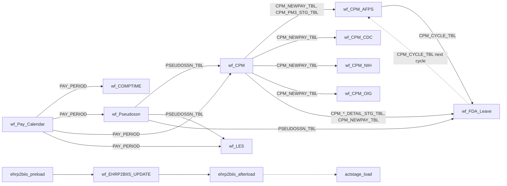

# PowerCenter → Databricks migration plan

Chubb is retiring Informatica PowerCenter in favour of Databricks. This plan covers every asset in this repo: the 11 workflow/mapping exports under `XML/`, the EHRP2BIIS pre/post-load SQL (`ehrp2biis_preload`, `ehrp2biis_afterload.sql`, `actstage_load`) and the `Maintenance Scripts/` and `Transfer Scripts/`.

## 1. Target architecture

| PowerCenter | Databricks |
|---|---|
| Repository folder (`CPM`, `LES`, ...) | Python package `biis_lakehouse.pipelines.<area>` |
| Workflow `wf_X` | Databricks Workflows job `wf_X` (Asset Bundle, `databricks/resources/*.yml`) |
| Session `s_Y` → mapping `m_Y` | Job task `s_Y` → `TASKS["s_Y"]` in `pipelines/<area>/wf_x.py`, run via `biis-run --workflow wf_X --task s_Y` |
| Oracle schemas `HISTDBA`, `INFO_TARGET_DEV`, `NKNIGHT`, `EHRP` | Unity Catalog `${catalog}.histdba`, `.biis`, `.nknight`, `.ehrp` (`RunContext.table_name`) |
| Oracle target tables | Delta tables, same name lower-cased |
| Flat-file / VSAM / PowerExchange (`PWX_SEQ_NRDB2`) sources & targets | Fixed-width text files in UC Volume `/Volumes/<catalog>/landing/files/{in,out,archive}/<AREA>/` (`common/fixed_width.py`) |
| `$Param_Root_Directory/data/int` | `RunContext.landing_root` |
| `BIIS_parms.iparms` parameter file | Bundle variables → job parameters → `--param KEY=VALUE` |
| `$$WF_*` workflow variables / `SETVARIABLE` | Task returns a dict → `dbutils.jobs.taskValues` (`workflow_vars`) → read by downstream tasks via `--upstream-task` |
| Email tasks / `mailx` | Job `email_notifications` + message-builder task output |
| Pre/post session shell commands (`mv`, `cp`, `remove_file.sh`) | `biis_lakehouse.ops` tasks using `dbutils.fs` / Python on Volumes |
| SQL*Plus scripts | Databricks SQL files under `databricks/sql/` run by `biis_lakehouse.sqlsteps` (or SQL tasks) |
| SFTP transfer scripts | `ops` SFTP task (paramiko, key from secret scope) or documented hand-off to an MFT; see unit 4 |

The shared scaffolding in this PR (`databricks/src/biis_lakehouse/`) is what all units build on:

- `context.py` — `RunContext` (spark, catalog, landing root, params) and the `Task` signature.
- `runner.py` — `biis-run` CLI and the `WORKFLOW_MODULES` registry (module paths are fixed here so units don't collide).
- `common/delta.py` — `overwrite`, `append`, `merge` (Delta MERGE honouring `DD_INSERT/UPDATE/DELETE/REJECT`), `update_strategy`.
- `common/fixed_width.py` — fixed-width read/write for flat-file, VSAM copybook and PowerExchange records.
- `tests/conftest.py` — local Delta-enabled `SparkSession` (no workspace needed) and a `ctx` fixture.

## 2. Inventory (generated from `XML/*`)

Counts are transformation *instances* inside mappings (reusable transformations and mapplet internals included once per use).

| Export | Folder | Mappings | Sessions | Sources (by type) | Targets (by type) | SQ | EXP | LKP | JNR | AGG | RTR | FIL | UPD | SEQ | SRT | NRM | MPLT |
|---|---|---|---|---|---|---|---|---|---|---|---|---|---|---|---|---|---|
| `XML/COMPTIME` | COMP_TIME | 3 | 3 | Flat File 1, Oracle 1 | Flat File 2, Oracle 2 | 3 | 11 | 2 | 0 | 1 | 0 | 2 | 0 | 0 | 0 | 0 | 0 |
| `XML/CPM` | CPM | 15 | 15 | Oracle 13, VSAM 5 | Flat File 3, Oracle 20 | 14 | 71 | 22 | 4 | 9 | 4 | 4 | 0 | 0 | 0 | 9 | 20 |
| `XML/CPM_AFPS` | CPM | 17 | 17 | Oracle 8 | Flat File 7, Oracle 5, PWX_SEQ_NRDB2 1 | 21 | 43 | 7 | 4 | 7 | 0 | 0 | 1 | 0 | 1 | 4 | 0 |
| `XML/CPM_CDC` | CPM | 6 | 6 | Oracle 3 | Flat File 4, PWX_SEQ_NRDB2 2 | 6 | 17 | 6 | 0 | 1 | 0 | 0 | 0 | 0 | 0 | 0 | 0 |
| `XML/CPM_NIH` | CPM | 6 | 6 | Oracle 3 | Flat File 4, PWX_SEQ_NRDB2 2 | 6 | 17 | 6 | 0 | 1 | 0 | 0 | 0 | 0 | 0 | 0 | 0 |
| `XML/CPM_OIG` | CPM | 4 | 4 | Oracle 2 | Flat File 3, PWX_SEQ_NRDB2 1 | 4 | 16 | 5 | 0 | 1 | 0 | 0 | 1 | 0 | 0 | 0 | 0 |
| `XML/EHRP2BIIS_UPDATE` | EHRP2BIIS | 1 | 1 | Oracle 2 | Oracle 3 | 1 | 3 | 9 | 0 | 0 | 0 | 0 | 0 | 0 | 0 | 0 | 0 |
| `XML/FDA_Leave` | CPM | 10 | 10 | Flat File 2, Oracle 5 | Flat File 5, Oracle 4 | 11 | 33 | 23 | 1 | 3 | 0 | 7 | 1 | 0 | 2 | 3 | 0 |
| `XML/LES` | LES | 32 | 32 | Flat File 1, Oracle 20, VSAM 15 | Flat File 5, Oracle 30 | 31 | 90 | 17 | 17 | 4 | 1 | 38 | 0 | 5 | 0 | 21 | 0 |
| `XML/Pay_Calendar` | Pay_Calendar | 4 | 4 | Oracle 1 | Flat File 2, Oracle 1 | 4 | 10 | 3 | 0 | 0 | 1 | 0 | 3 | 0 | 0 | 0 | 0 |
| `XML/Pseudossn` | Pseudossn | 10 | 10 | Flat File 2, Oracle 3 | Flat File 3, Oracle 6 | 11 | 32 | 12 | 1 | 2 | 1 | 10 | 1 | 0 | 2 | 2 | 0 |
| **Total** | | 108 | 108 | | | **112** | **343** | **112** | **27** | **29** | **7** | **61** | **7** | **5** | **5** | **39** | **20** |

`XML/Pseudossn` and the root-level `Pseudossn` file are byte-identical; only the `XML/` copy is converted.

### 2.1 Workflows, schedules and parameters

| Workflow | Target module | Schedule | Parameter file | Workflow variables |
|---|---|---|---|---|
| `wf_COMPTIME` | `pipelines/reference/wf_comptime.py` | ONDEMAND | `/data/BIISINT/control/BIIS_parms.iparms` | `$$WF_PP_YEAR_NUM`, `$$WF_COMPTIME_EMAIL_LIST`, `$$WF_SUBJECT`, `$$WF_MESSAGE`, `$$WF_PP_END_YEAR`, `$$WF_PP_NUM` |
| `wf_CPM` | `pipelines/cpm/wf_cpm.py` | ONDEMAND | `/data/BIISINT/control/BIIS_parms.iparms` | `$$WF_CPM_EMAIL_LIST`, `$$WF_PP_END_YEAR`, `$$WF_PP_NUM`, `$$WF_SUBJECT`, `$$WF_MESSAGE`, `$$WF_PP_YEAR_NUM`, `$$WF_NEW_MER_FLAG` |
| `wf_CPM_AFPS` | `pipelines/cpm_extracts/wf_cpm_afps.py` | ONDEMAND | `/data/BIISINT/control/BIIS_parms.iparms` | `$$WF_PP_END_YEAR_LAST_DIGIT`, `$$WF_PP_YEAR_NUM`, `$$WF_PP_END_YEAR`, `$$WF_CPM_EMAIL_LIST`, `$$WF_PP_NUM`, `$$WF_AFPS_EMAIL_LIST`, `$$WF_SUBJECT`, `$$WF_MESSAGE`, `$$WF_CYCLE_ID` |
| `wf_CPM_CDC` | `pipelines/cpm_extracts/wf_cpm_cdc.py` | ONDEMAND | `/data/BIISINT/control/BIIS_parms.iparms` | `$$WF_SUBJECT`, `$$WF_MESSAGE`, `$$WF_CPM_EMAIL_LIST`, `$$WF_CPM_CDC_EMAIL_LIST`, `$$WF_PP_YEAR_NUM`, `$$WF_PP_END_YEAR`, `$$WF_PP_NUM` |
| `wf_CPM_NIH` | `pipelines/cpm_extracts/wf_cpm_nih.py` | ONDEMAND | `/data/BIISINT/control/BIIS_parms.iparms` | `$$WF_PP_END_YEAR`, `$$WF_PP_NUM`, `$$WF_CPM_NIH_EMAIL_LIST`, `$$WF_SUBJECT`, `$$WF_MESSAGE`, `$$WF_CPM_EMAIL_LIST`, `$$WF_PP_YEAR_NUM` |
| `wf_CPM_OIG` | `pipelines/cpm_extracts/wf_cpm_oig.py` | ONDEMAND | `/data/BIISINT/control/BIIS_parms.iparms` | `$$WF_CPM_OIG_EMAIL_LIST`, `$$WF_CPM_OIG_DIR`, `$$WF_MESSAGE`, `$$WF_SUBJECT`, `$$WF_PP_END_YEAR`, `$$WF_PP_NUM`, `$$WF_CPM_EMAIL_LIST`, `$$WF_PP_YEAR_NUM` |
| `wf_EHRP2BIIS_UPDATE` | `pipelines/ehrp/wf_ehrp2biis_update.py` | RECURRING every 1 day from 2018-09-28 12:00, run forever | `-` | - |
| `wf_FDA_Leave` | `pipelines/cpm_extracts/wf_fda_leave.py` | ONDEMAND | `/data/BIISINT/control/BIIS_parms.iparms` | `$$WF_CPM_EMAIL_LIST`, `$$WF_SUBJECT`, `$$WF_MESSAGE`, `$$WF_FDA_LV_EMAIL_LIST`, `$$WF_PP_END_YEAR`, `$$WF_PP_NUM`, `$$WF_CYCLE_ID` |
| `wf_LES` | `pipelines/les/wf_les.py` | ONDEMAND | `/data/BIISINT/control/BIIS_parms.iparms` | `$$WF_PP_END_YEAR`, `$$WF_PP_NUM`, `$$WF_LES_EMAIL_LIST`, `$$WF_SUBJECT`, `$$WF_MESSAGE`, `$$WF_LES_INPUT_DIR`, `$$WF_PP_YEAR_NUM` |
| `wf_Pay_Calendar` | `pipelines/reference/wf_pay_calendar.py` | ONDEMAND | `/data/BIISINT/control/BIIS_parms.iparms` | `$$WF_PAY_CALENDAR_EMAIL_LIST`, `$$WF_SUBJECT`, `$$WF_MESSAGE`, `$$WF_PP_END_YEAR`, `$$WF_PP_NUM` |
| `wf_Pseudossn` | `pipelines/reference/wf_pseudossn.py` | ONDEMAND | `/data/BIISINT/control/BIIS_parms.iparms` | `$$WF_SUBJECT`, `$$WF_MESSAGE`, `$$WF_PSEUDOSSN_EMAIL_LIST`, `$$WF_PP_YEAR_NUM` |

Mapping variables (`$$MAP_*`) are assigned from workflow variables (`$$WF_*`) via session pre/post variable assignment, and `SETVARIABLE` in Expression ports pushes values back. `$Param_*` connection/file names come from `BIIS_parms.iparms` (not in the repo); they become bundle variables / job parameters (see section 5).

### 2.2 Session chains (workflow links)

Every link condition is `$<prev>.Status = Succeeded` (or unconditional from `Start`), so each workflow is a strict linear chain: in Databricks every task `depends_on` its predecessor with the default `ALL_SUCCESS` outcome. Email tasks become job notifications plus a final notify task.

- **wf_COMPTIME** (4 tasks): `s_COMPTIME_Current_Pay_Period` → `s_COMPTIME_Load_COMP_TIME_DAILY_TBL` → `s_COMPTIME_Build_Message_Counters` → `email_COMPTIME_Complete`
- **wf_CPM** (15 tasks): `s_CPM_Current_Pay_Period` → `s_CPM_Load_CPM_MER_Staging_Tables` → `s_CPM_Load_CPM_PAD_Staging_Tables` → `s_CPM_Load_CPM_YTD_Staging_Tables` → `s_CPM_Load_CPM_PMR_Staging_Tables` → `s_CPM_Load_CPM_NEWPAY_STG_YTD_STATE_TBL` → `s_CPM_Load_CPM_NEWPAY_STG_ALT_TBL` → `s_CPM_Load_CPM_NEWPAY_STG_DETAIL_TBL` → `s_CPM_Load_CPM_NEWPAY_STG_TYPE_1_2_TBL` → `s_CPM_Load_CPM_NEWPAY_STG_TYPE_3_FDR_TBL` → `s_CPM_Load_From_FDR_CPM_NEWPAY_STG_TYPE_3_TBL` → `s_CPM_Load_FDR_CPM_NEWPAY_TBL` → `s_CPM_Load_CPM_NEWPAY_TBL` → `s_CPM_Build_Message_Counters` → `s_CPM_Send_Counts`
- **wf_CPM_AFPS** (17 tasks): `s_CPM_AFPS_0010_Set_CPM_Calendar` → `s_CPM_AFPS_0025_Set_Pay_Calendar` → `s_CPM_AFPS_0050_Update_CPM_CYCLE_TBL` → `s_CPM_AFPS_0100_Data_Seperate` → `s_CPM_AFPS_0200_Debridge_To_FEEDER_FLAT` → `s_CPM_AFPS_0300_Gross_Exp_Report` → `s_CPM_AFPS_0400_Crossfoot_Errors` → `s_CPM_AFPS_0500_Crossfoot_Message_Header` → `s_CPM_AFPS_0600_Crossfoot_Message_Details` → `s_CPM_AFPS_0700_Crossfoot_Message_Summary_Counts` → `s_CPM_AFPS_0720_Crossfoot_Message_Gross_Expend` → `s_CPM_AFPS_0760_Concatenate_Crossfoot_Files` → `s_CPM_AFPS_0800_Build_Message_Counters` → `s_CPM_AFPS_0820_Build_Message_Totals` → `s_CPM_AFPS_0860_Concatenate_Counts_Files` → `s_CPM_AFPS_0900_Build_Message` → `s_CPM_AFPS_1000_Send_Report`
- **wf_CPM_CDC** (7 tasks): `s_CPM_CDC_Set_CPM_Calendar` → `s_CPM_CDC_Set_Pay_Calendar` → `s_CPM_CDC_Load_CPM_CDC_Header_File` → `s_CPM_CDC_Load_CPM_CDC_Data_File` → `s_CPM_CDC_Concatenate_Files` → `s_CPM_CDC_Build_Message` → `email_CPM_CDC`
- **wf_CPM_NIH** (7 tasks): `s_CPM_NIH_Set_CPM_Calendar` → `s_CPM_NIH_Set_Pay_Calendar` → `s_CPM_NIH_Load_CPM_NIH_Header_File` → `s_CPM_NIH_Load_CPM_NIH_Data_File` → `s_CPM_NIH_Concatenate_Files` → `s_CPM_NIH_Build_Message` → `email_CPM_NIH`
- **wf_CPM_OIG** (5 tasks): `s_CPM_OIG_Set_CPM_Calendar` → `s_CPM_OIG_Set_Pay_Calendar` → `s_CPM_OIG_Load_CPM_OIG_File` → `s_CPM_OIG_Build_Message` → `email_CPM_OIG`
- **wf_EHRP2BIIS_UPDATE** (1 tasks): `s_m_EHRP2BIIS_UPDATE`
- **wf_FDA_Leave** (10 tasks): `s_0010_PM_FDA_Verify_File` → `s_0020_PM_FDA_Set_CPM_Calendar` → `s_0025_PM_FDA_Set_Pay_Calendar` → `s_0050_PM_FDA_Update_CPM_CYCLE_TBL_FDA` → `s_0100_PM_FDA_Load_TATRAN_To_DB` → `s_0150_PM_FDA_Error_Counter` → `s_0200_PM_FDA_Create_200_Rows` → `s_0300_PM_FDA_Create_Output_File` → `s_0500_PM_FDA_IO_Counter` → `s_1100_PM_FDA_Send_Email`
- **wf_LES** (33 tasks): `s_LES_Current_Pay_Period` → `s_LES_Verify_Header` → `s_LES_Verify_Record_Count` → `s_LES_Load_LES_HEADER_TBL` → `s_LES_Load_LES_EMP_DETAIL_TBL` → `s_LES_Load_LES_EMP_DETAIL_RECTYPE_1_TBL` → `s_LES_Load_LES_EMP_DETAIL_RECTYPE_2_TBL` → `s_LES_Load_LES_EMP_DETAIL_RECTYPE_3_TBL` → `s_LES_Load_LES_EMP_DETAIL_RECTYPE_4_TBL` → `s_LES_Load_LES_EMP_DETAIL_RECTYPE_5_TBL` → `s_LES_Load_LES_EMP_DETAIL_RECTYPE_6_TBL` → `s_LES_Load_LES_EMP_DETAIL_RECTYPE_C_TBL` → `s_LES_Load_LES_EMP_DETAIL_RECTYPE_R_TBL` → `s_LES_Load_LES_EMP_DETAIL_RECTYPE_D_TBL` → `s_LES_Load_LES_EMP_DETAIL_RECTYPE_L_TBL` → `s_LES_Load_LES_EMP_DETAIL_RECTYPE_U_TBL` → `s_LES_Load_LES_EMP_DETAIL_RECTYPE_M_TBL` → `s_LES_Load_LES_EMP_DETAIL_RECTYPE_T_TBL` → `s_LES_Load_LES_PRIMARY_DATA_TBL` → `s_LES_Load_LES_EMP_DETAIL_CURR_EARN_TBL` → `s_LES_Load_LES_EMP_DETAIL_RETRO_EARN_TBL` → `s_LES_Load_LES_EMP_DETAIL_LEAVE_TBL` → `s_LESRPT_Load_LESC` → `s_LESRPT_Load_LESD` → `s_LESRPT_Load_LESL` → `s_LESRPT_Load_LESM` → `s_LESRPT_Load_LESR` → `s_LESRPT_Load_LESS` → `s_LESRPT_Load_LEST` → `s_LESRPT_Load_LESU` → `s_LES_NIH_FILE` → `s_LES_Build_Message_Counters` → `email_LES_Complete`
- **wf_Pay_Calendar** (5 tasks): `s_Pay_Calendar_Reset_Pay_Calendar` → `s_Pay_Calendar_Set_Pay_Calendar` → `s_Pay_Calendar_Verify_Pay_Calendar` → `s_Pay_Calendar_Build_Message` → `Email_Pay_Calendar`
- **wf_Pseudossn** (11 tasks): `s_Pseudossn_Verify_Header_Date_Current_Pay_Period` → `s_Pseudossn_Verify_Record_Count` → `s_Pseudossn_Verify_Header_Date_Current_Pay_Period_Pseudossn_From_SDA` → `s_Pseudossn_Current_Pay_Period` → `s_Pseudossn_Load_Archive_Pseudossn_Tbl` → `s_Pseudossn_Load_Pseudossn_Tbl` → `s_Pseudossn_Load_Pseudossn_From_SDA_Tbl` → `s_Pseudossn_Update_Timekeeper_Number` → `s_Pseudossn_Load_SDA_Records_Pseudossn_Tbl` → `s_Pseudossn_Counters` → `Email_Pseudossn`

### 2.3 Mappings

<b>COMPTIME</b> — 3 mappings

| Mapping | Session | Transformations |
|---|---|---|
| `m_COMPTIME_Build_Message_Counters` | `s_COMPTIME_Build_Message_Counters` | Expression 6, Filter 1, Aggregator 1, Source Qualifier 1, Lookup Procedure 1 |
| `m_COMPTIME_Load_COMP_TIME_DAILY_TBL` | `s_COMPTIME_Load_COMP_TIME_DAILY_TBL` | Source Qualifier 1, Expression 3, Lookup Procedure 1, Filter 1 |
| `m_COMPTIME_Current_Pay_Period` | `s_COMPTIME_Current_Pay_Period` | Source Qualifier 1, Expression 2 |

Sources: `HISTDBA.PAY_PERIOD` (Oracle), `U0287D01` (Flat File)

Targets: `COMPTIME_MESSAGE_FILE` (Flat File), `COMP_TIME_DAILY_TBL` (Oracle), `COMP_TIME_DATE_FILE` (Flat File), `COUNTER_TBL` (Oracle)

Session commands (become `ops` tasks / Volume file operations):

- post_session_success_command: `mv $Param_Root_Directory/data/int/in/COMPTIME/$Param_COMPTIME_filename  $Param_Root_Directory/data/archive/COMPTIME/u0827d01_P$$WF_PP_YEAR_NUM.txt`

<b>CPM</b> — 15 mappings

| Mapping | Session | Transformations |
|---|---|---|
| `m_CPM_Current_Pay_Period` | `s_CPM_Current_Pay_Period` | Source Qualifier 1, Expression 2 |
| `m_CPM_Load_CPM_NEWPAY_STG_ALT_TBL` | `s_CPM_Load_CPM_NEWPAY_STG_ALT_TBL` | Filter 2, Normalizer 1, Expression 6, Source Qualifier 1, Aggregator 1, Mapplet 1, Lookup Procedure 1 |
| `m_CPM_Load_CPM_YTD_Staging_Tables` | `s_CPM_Load_CPM_YTD_Staging_Tables` | Expression 6, Lookup Procedure 2, Normalizer 1, Router 1 |
| `m_CPM_Load_CPM_NEWPAY_STG_YTD_STATE_TBL` | `s_CPM_Load_CPM_NEWPAY_STG_YTD_STATE_TBL` | Expression 4, Aggregator 1, Source Qualifier 1, Mapplet 1 |
| `m_CPM_Load_CPM_MER_Staging_Tables` | `s_CPM_Load_CPM_MER_Staging_Tables` | Expression 5, Lookup Procedure 2, Router 1, Normalizer 1 |
| `m_CPM_Load_CPM_NEWPAY_STG_TYPE_1_2_TBL` | `s_CPM_Load_CPM_NEWPAY_STG_TYPE_1_2_TBL` | Filter 2, Source Qualifier 2, Expression 9, Lookup Procedure 3, Normalizer 1, Joiner 1, Mapplet 6 |
| `m_CPM_Load_CPM_NEWPAY_STG_DETAIL_TBL` | `s_CPM_Load_CPM_NEWPAY_STG_DETAIL_TBL` | Expression 3, Source Qualifier 1, Aggregator 1 |
| `m_CPM_Build_Message_Counters` | `s_CPM_Build_Message_Counters` | Normalizer 3, Expression 9, Lookup Procedure 4, Source Qualifier 3, Joiner 3, Aggregator 4 |
| `m_CPM_Load_CPM_PMR_Staging_Tables` | `s_CPM_Load_CPM_PMR_Staging_Tables` | Expression 7, Lookup Procedure 2, Normalizer 1, Router 1 |
| `m_CPM_Load_CPM_PAD_Staging_Tables` | `s_CPM_Load_CPM_PAD_Staging_Tables` | Expression 5, Lookup Procedure 2, Normalizer 1, Router 1 |
| `m_CPM_Load_PMR_To_CPM_NEWPAY_TBL` | `s_CPM_Load_CPM_NEWPAY_TBL` | Expression 3, Source Qualifier 1 |
| `m_Generic_Mapping` | `s_CPM_Send_Counts` | Source Qualifier 1 |
| `m_CPM_Load_FDR_CPM_NEWPAY_TBL` | `s_CPM_Load_FDR_CPM_NEWPAY_TBL` | Expression 3, Source Qualifier 1, Lookup Procedure 1 |
| `m_CPM_Load_CPM_NEWPAY_STG_TYPE_3_FDR_TBL` | `s_CPM_Load_CPM_NEWPAY_STG_TYPE_3_FDR_TBL` | Expression 6, Aggregator 1, Lookup Procedure 2, Source Qualifier 1, Mapplet 12 |
| `m_CPM_Load_CPM_NEWPAY_STG_TYPE_3_TBL` | `s_CPM_Load_From_FDR_CPM_NEWPAY_STG_TYPE_3_TBL` | Expression 3, Aggregator 1, Lookup Procedure 3, Source Qualifier 1 |

Sources: `HISTDBA.PAY_PERIOD` (Oracle), `INFO_TARGET_DEV.CPM_NEWPAY_STG_TYPE_1_2_TBL` (Oracle), `INFO_TARGET_DEV.CPM_NEWPAY_STG_TYPE_3_FDR_TBL` (Oracle), `INFO_TARGET_DEV.CPM_NEWPAY_STG_TYPE_3_TBL` (Oracle), `INFO_TARGET_DEV.CPM_NEWPAY_TBL` (Oracle), `INFO_TARGET_DEV.CPM_PM1_STG_TBL` (Oracle), `INFO_TARGET_DEV.CPM_PM2_STG_TBL` (Oracle), `INFO_TARGET_DEV.CPM_PM3_STG_TBL` (Oracle), `INFO_TARGET_DEV.CPM_YTD_DETAIL_STG_TBL` (Oracle), `INFO_TARGET_DEV.CPM_YTD_STATE_STG_TBL` (Oracle), `INFO_TARGET_DEV.ERROR_TBL` (Oracle), `INFO_TARGET_DEV.HI_GENERIC_SRC_TBL` (Oracle), `INFO_TARGET_DEV.PSEUDOSSN_TBL` (Oracle), `MER_FILE` (VSAM), `PAD_FILE` (VSAM), `PAYMASTER_FILE` (VSAM), `PAYMASTER_THREE` (VSAM), `YTD_FILE` (VSAM)

Targets: `COUNTER_TBL` (Oracle), `CPM_MER_DETAIL_STG_TBL` (Oracle), `CPM_MER_HEADER_STG_TBL` (Oracle), `CPM_MESSAGE_FILE` (Flat File), `CPM_NEWPAY_STG_ALT_TBL` (Oracle), `CPM_NEWPAY_STG_DETAIL_TBL` (Oracle), `CPM_NEWPAY_STG_TYPE_1_2_TBL` (Oracle), `CPM_NEWPAY_STG_TYPE_3_FDR_TBL` (Oracle), `CPM_NEWPAY_STG_TYPE_3_TBL` (Oracle), `CPM_NEWPAY_STG_YTD_STATE_TBL` (Oracle), `CPM_NEWPAY_TBL` (Oracle), `CPM_PAD_DETAIL_STG_TBL` (Oracle), `CPM_PAD_HEADER_STG_TBL` (Oracle), `CPM_PAY_PERIOD_DATE_FILE` (Flat File), `CPM_PM1_STG_TBL` (Oracle), `CPM_PM2_STG_TBL` (Oracle), `CPM_PM3_STG_TBL` (Oracle), `CPM_PMH_STG_TBL` (Oracle), `CPM_YTD_DETAIL_STG_TBL` (Oracle), `CPM_YTD_HEADER_STG_TBL` (Oracle), `CPM_YTD_STATE_STG_TBL` (Oracle), `ERROR_TBL` (Oracle), `GENERIC_TARGET_FILE` (Flat File)

Session commands (become `ops` tasks / Volume file operations):

- post_session_success_command: `mv $Param_Root_Directory/data/int/in/CPM/$Param_CPM_Biweekly_MER_filename  $Param_Root_Directory/data/archive/CPM/p6722d01_P$$WF_PP_YEAR_NUM.txt`
- post_session_success_command: `mv $Param_Root_Directory/data/int/in/CPM/$Param_CPM_PAD_filename  $Param_Root_Directory/data/archive/CPM/p6331x01_P$$WF_PP_YEAR_NUM.txt`
- post_session_success_command: `mv $Param_Root_Directory/data/int/in/CPM/$Param_CPM_Department_of_Energy_filename  $Param_Root_Directory/data/archive/CPM/p6310de2_P$$WF_PP_YEAR_NUM.txt`
- post_session_success_command: `mv $Param_Root_Directory/data/int/in/CPM/$Param_CPM_Year_To_Date_filename  $Param_Root_Directory/data/archive/CPM/p6791x01_P$$WF_PP_YEAR_NUM.txt`

<b>CPM_AFPS</b> — 17 mappings

| Mapping | Session | Transformations |
|---|---|---|
| `m_CPM_AFPS_0100_Data_Seperate` | `s_CPM_AFPS_0100_Data_Seperate` | Source Qualifier 1, Expression 3, Sorter 1 |
| `m_CPM_AFPS_0300_Gross_Exp_Report` | `s_CPM_AFPS_0300_Gross_Exp_Report` | Expression 1, Source Qualifier 1 |
| `m_CPM_AFPS_0720_Crossfoot_Message_Gross_Expend` | `s_CPM_AFPS_0720_Crossfoot_Message_Gross_Expend` | Expression 3, Source Qualifier 1, Aggregator 1 |
| `m_CPM_AFPS_0700_Crossfoot_Message_Summary_Counts` | `s_CPM_AFPS_0700_Crossfoot_Message_Summary_Counts` | Source Qualifier 2, Expression 4, Aggregator 2, Joiner 1, Normalizer 1 |
| `m_CPM_AFPS_0800_Build_Message_Counters` | `s_CPM_AFPS_0800_Build_Message_Counters` | Expression 5, Aggregator 2, Normalizer 2, Source Qualifier 2, Joiner 1 |
| `m_CPM_AFPS_0900_Build_Message` | `s_CPM_AFPS_0900_Build_Message` | Source Qualifier 1, Expression 2 |
| `m_CPM_AFPS_0760_Concatenate_Crossfoot_Files` | `s_CPM_AFPS_0760_Concatenate_Crossfoot_Files` | Source Qualifier 1 |
| `m_CPM_AFPS_1000_Send_Report` | `s_CPM_AFPS_1000_Send_Report` | Source Qualifier 1 |
| `m_CPM_AFPS_0500_Crossfoot_Message_Header` | `s_CPM_AFPS_0500_Crossfoot_Message_Header` | Expression 3, Source Qualifier 1 |
| `m_CPM_AFPS_0820_Build_Message_Totals` | `s_CPM_AFPS_0820_Build_Message_Totals` | Source Qualifier 2, Expression 5, Aggregator 2, Joiner 1, Normalizer 1 |
| `m_CPM_AFPS_0860_Concatenate_Counts_Files` | `s_CPM_AFPS_0860_Concatenate_Counts_Files` | Source Qualifier 1 |
| `m_CPM_AFPS_0025_Set_Pay_Calendar` | `s_CPM_AFPS_0025_Set_Pay_Calendar` | Expression 4, Lookup Procedure 3, Source Qualifier 1 |
| `m_CPM_AFPS_0600_Crossfoot_Message_Details` | `s_CPM_AFPS_0600_Crossfoot_Message_Details` | Expression 3, Source Qualifier 1 |
| `m_CPM_AFPS_0050_Update_CPM_CYCLE_TBL` | `s_CPM_AFPS_0050_Update_CPM_CYCLE_TBL` | Update Strategy 1, Source Qualifier 1, Expression 2, Lookup Procedure 1 |
| `m_CPM_AFPS_0010_Set_CPM_Calendar` | `s_CPM_AFPS_0010_Set_CPM_Calendar` | Expression 6, Lookup Procedure 2, Source Qualifier 1 |
| `m_CPM_AFPS_0200_Debridge_To_FEEDER_FLAT` | `s_CPM_AFPS_0200_Debridge_To_FEEDER_FLAT` | Source Qualifier 1 |
| `m_CPM_AFPS_0400_Crossfoot_Errors` | `s_CPM_AFPS_0400_Crossfoot_Errors` | Source Qualifier 2, Expression 2, Lookup Procedure 1, Joiner 1 |

Sources: `HISTDBA.PAY_PERIOD` (Oracle), `INFO_TARGET_DEV.CPM_CYCLE_TBL` (Oracle), `INFO_TARGET_DEV.CPM_NEWPAY_TBL` (Oracle), `INFO_TARGET_DEV.CPM_PM3_STG_TBL` (Oracle), `INFO_TARGET_DEV.ERROR_TBL` (Oracle), `INFO_TARGET_DEV.HI_AFPS_FEEDER_TBL` (Oracle), `INFO_TARGET_DEV.HI_GENERIC_SRC_TBL` (Oracle), `INFO_TARGET_DEV.HI_GROSS_EXP_TBL` (Oracle)

Targets: `AFPS_COUNTER_TBL` (Oracle), `CPM_AFPS_CROSSFOOT_FILE` (Flat File), `CPM_AFPS_MESSAGE_COUNTS_FILE` (Flat File), `CPM_AFPS_MESSAGE_COUNTS_TOT_FILE` (Flat File), `CPM_AFPS_MESSAGE_FILE` (Flat File), `CPM_AFPS_PAY_PERIOD_CAL_FILE` (Flat File), `CPM_AFPS_PAY_PERIOD_FILE` (Flat File), `CPM_CYCLE_TBL` (Oracle), `ERROR_TBL` (Oracle), `GENERIC_TARGET_FILE` (Flat File), `HI_AFPS_FEEDER_TBL` (Oracle), `HI_GROSS_EXP_TBL` (Oracle), `feeder_FEEDER_RECORD` (PWX_SEQ_NRDB2)

Session commands (become `ops` tasks / Volume file operations):

- post_session_success_command: `cp $Param_Root_Directory/data/int/out/CPM/$Param_CPM_AFPS_out_filename $Param_Root_Directory/data/int/out/CPM/AFPS_FLAT_PP$$WF_PP_NUM.txt`
- post_session_success_command: `cp $Param_Root_Directory/data/int/in/CPM/$Param_CPM_GPRecon_filename $Param_Root_Directory/data/int/out/CPM/P3306D04.GPRECON.P$$WF_PP_END_YEAR_LAST_DIGIT$$WF_PP_NUM`
- post_session_success_command: `/home/sa-infoadm/scripts/afps_transfer.sh AFPS_FLAT_PP$$WF_PP_NUM.txt`
- post_session_success_command: `/home/sa-infoadm/scripts/afps_transfer.sh P3306D04.GPRECON.P$$WF_PP_END_YEAR_LAST_DIGIT$$WF_PP_NUM`
- post_session_success_command: `mv $Param_Root_Directory/data/int/in/CPM/$Param_CPM_GPRecon_filename $Param_Root_Directory/data/archive/CPM/p3306d04_P$$WF_PP_YEAR_NUM.txt`
- post_session_success_command: `cp $Param_Root_Directory/data/int/in/CPM/$Param_CPM_DDForm_filename $Param_Root_Directory/data/int/out/CPM/P6615X01.P$$WF_PP_END_YEAR_LAST_DIGIT$$WF_PP_NUM`
- post_session_success_command: `/home/sa-infoadm/scripts/afps_transfer.sh P6615X01.P$$WF_PP_END_YEAR_LAST_DIGIT$$WF_PP_NUM`
- post_session_success_command: `mv $Param_Root_Directory/data/int/in/CPM/$Param_CPM_DDForm_filename $Param_Root_Directory/data/archive/CPM/p6615x01_P$$WF_PP_YEAR_NUM.txt`
- pre_session_command: `$Param_ControlDir/scripts/remove_file.sh $Param_Root_Directory/data/int/out/CPM $Param_CPM_AFPS_out_filename`

<b>CPM_CDC</b> — 6 mappings

| Mapping | Session | Transformations |
|---|---|---|
| `m_CPM_CDC_Load_CPM_CDC_Header_File` | `s_CPM_CDC_Load_CPM_CDC_Header_File` | Expression 2, Source Qualifier 1 |
| `m_CPM_CDC_Concatenate_Files` | `s_CPM_CDC_Concatenate_Files` | Source Qualifier 1 |
| `m_CPM_CDC_Set_Pay_Calendar` | `s_CPM_CDC_Set_Pay_Calendar` | Expression 4, Lookup Procedure 3, Source Qualifier 1 |
| `m_CPM_CDC_Load_CPM_CDC_Data_File` | `s_CPM_CDC_Load_CPM_CDC_Data_File` | Source Qualifier 1, Expression 4 |
| `m_CPM_CDC_Set_CPM_Calendar` | `s_CPM_CDC_Set_CPM_Calendar` | Lookup Procedure 2, Expression 4, Source Qualifier 1 |
| `m_CPM_CDC_Build_Message` | `s_CPM_CDC_Build_Message` | Source Qualifier 1, Expression 3, Aggregator 1, Lookup Procedure 1 |

Sources: `HISTDBA.PAY_PERIOD` (Oracle), `INFO_TARGET_DEV.CPM_NEWPAY_TBL` (Oracle), `INFO_TARGET_DEV.HI_GENERIC_SRC_TBL` (Oracle)

Targets: `CPM_CDC_CPM_PAY_PERIOD_FILE` (Flat File), `CPM_CDC_MESSAGE_FILE` (Flat File), `CPM_CDC_PAY_PERIOD_FILE` (Flat File), `GENERIC_TARGET_FILE` (Flat File), `cdchdr_WS_CDC_HDR` (PWX_SEQ_NRDB2), `cdcskel_WS_PAY_OUT_REC` (PWX_SEQ_NRDB2)

Session commands (become `ops` tasks / Volume file operations):

- pre_session_command: `$Param_ControlDir/scripts/remove_file.sh $Param_Root_Directory/data/int/out/CPM $Param_CPM_CDC_DAT_filename`
- pre_session_command: `$Param_ControlDir/scripts/remove_file.sh $Param_Root_Directory/data/int/out/CPM $Param_CPM_CDC_out_filename`
- post_session_success_command: `cd $Param_Root_Directory/data/int/out/CPM; cat $Param_CPM_CDC_HDR_filename $Param_CPM_CDC_DAT_filename > $Param_CPM_CDC_out_filename`
- pre_session_command: `$Param_ControlDir/scripts/remove_file.sh $Param_Root_Directory/data/int/out/CPM $Param_CPM_CDC_HDR_filename`
- post_session_success_command: `cd $Param_Root_Directory/data/int/out/CPM; cp $Param_CPM_CDC_out_filename CDC.CPM.PP$$WF_PP_YEAR_NUM`
- post_session_success_command: `/home/sa-infoadm/scripts/cdc_transfer.sh CDC.CPM.PP$$WF_PP_YEAR_NUM`

<b>CPM_NIH</b> — 6 mappings

| Mapping | Session | Transformations |
|---|---|---|
| `m_CPM_NIH_Build_Message` | `s_CPM_NIH_Build_Message` | Lookup Procedure 1, Source Qualifier 1, Expression 3, Aggregator 1 |
| `m_CPM_NIH_Load_CPM_NIH_Header_File` | `s_CPM_NIH_Load_CPM_NIH_Header_File` | Source Qualifier 1, Expression 2 |
| `m_CPM_NIH_Load_CPM_NIH_Data_File` | `s_CPM_NIH_Load_CPM_NIH_Data_File` | Source Qualifier 1, Expression 4 |
| `m_CPM_NIH_Set_CPM_Calendar` | `s_CPM_NIH_Set_CPM_Calendar` | Expression 4, Lookup Procedure 2, Source Qualifier 1 |
| `m_CPM_NIH_Concatenate_Files` | `s_CPM_NIH_Concatenate_Files` | Source Qualifier 1 |
| `m_CPM_NIH_Set_Pay_Calendar` | `s_CPM_NIH_Set_Pay_Calendar` | Expression 4, Lookup Procedure 3, Source Qualifier 1 |

Sources: `HISTDBA.PAY_PERIOD` (Oracle), `INFO_TARGET_DEV.CPM_NEWPAY_TBL` (Oracle), `INFO_TARGET_DEV.HI_GENERIC_SRC_TBL` (Oracle)

Targets: `CPM_NIH_CPM_PAY_PERIOD_FILE` (Flat File), `CPM_NIH_MESSAGE_FILE` (Flat File), `CPM_NIH_PAY_PERIOD_FILE` (Flat File), `GENERIC_TARGET_FILE` (Flat File), `nihhdr_WS_NIH_HDR` (PWX_SEQ_NRDB2), `nihtest_NIH_PAYROLL_MASTER` (PWX_SEQ_NRDB2)

Session commands (become `ops` tasks / Volume file operations):

- pre_session_command: `$Param_ControlDir/scripts/remove_file.sh $Param_Root_Directory/data/int/out/CPM $Param_CPM_NIH_out_filename`
- post_session_success_command: `cd $Param_Root_Directory/data/int/out/CPM; cat $Param_CPM_NIH_HDR_filename $Param_CPM_NIH_DAT_filename > $Param_CPM_NIH_out_filename`
- pre_session_command: `$Param_ControlDir/scripts/remove_file.sh $Param_Root_Directory/data/int/out/CPM $Param_CPM_NIH_DAT_filename`
- pre_session_command: `$Param_ControlDir/scripts/remove_file.sh $Param_Root_Directory/data/int/out/CPM $Param_CPM_NIH_HDR_filename`
- post_session_success_command: `cd $Param_Root_Directory/data/int/out/CPM; cp $Param_CPM_NIH_out_filename NIHPAYMASTER.PP$$WF_PP_YEAR_NUM`
- post_session_success_command: `/home/sa-infoadm/scripts/nih_cpm_transfer.sh NIHPAYMASTER.PP$$WF_PP_YEAR_NUM`

<b>CPM_OIG</b> — 4 mappings

| Mapping | Session | Transformations |
|---|---|---|
| `m_CPM_OIG_Build_Message` | `s_CPM_OIG_Build_Message` | Source Qualifier 1, Expression 3, Aggregator 1 |
| `m_CPM_OIG_Set_Pay_Calendar` | `s_CPM_OIG_Set_Pay_Calendar` | Expression 5, Lookup Procedure 3, Source Qualifier 1 |
| `m_CPM_OIG_Set_CPM_Calendar` | `s_CPM_OIG_Set_CPM_Calendar` | Expression 4, Lookup Procedure 2, Source Qualifier 1 |
| `m_CPM_OIG_Load_CPM_OIG_File` | `s_CPM_OIG_Load_CPM_OIG_File` | Source Qualifier 1, Expression 4, Update Strategy 1 |

Sources: `HISTDBA.PAY_PERIOD` (Oracle), `INFO_TARGET_DEV.CPM_NEWPAY_TBL` (Oracle)

Targets: `CPM_OIG_CPM_PAY_PERIOD_FILE` (Flat File), `CPM_OIG_MESSAGE_FILE` (Flat File), `CPM_OIG_PAY_PERIOD_FILE` (Flat File), `oigsgndec_SKPAYROLL_MASTER` (PWX_SEQ_NRDB2)

Session commands (become `ops` tasks / Volume file operations):

- pre_session_command: `$Param_ControlDir/scripts/remove_file.sh $Param_Root_Directory/data/int/out/CPM $Param_CPM_OIG_out_filename`
- post_session_success_command: `cd $Param_Root_Directory/data/int/out/CPM; cp $Param_CPM_OIG_out_filename OIG.CPM.PP$$WF_PP_YEAR_NUM.TXT`
- post_session_success_command: `/home/sa-infoadm/scripts/oig_transfer.sh OIG.CPM.PP$$WF_PP_YEAR_NUM.TXT`

<b>EHRP2BIIS_UPDATE</b> — 1 mappings

| Mapping | Session | Transformations |
|---|---|---|
| `m_EHRP2BIIS_UPDATE` | `s_m_EHRP2BIIS_UPDATE` | Expression 3, Lookup Procedure 9, Source Qualifier 1 |

Sources: `EHRP.PS_GVT_JOB` (Oracle), `NKNIGHT.NWK_NEW_EHRP_ACTIONS_TBL` (Oracle)

Targets: `EHRP_RECS_TRACKING_TBL` (Oracle), `NWK_ACTION_PRIMARY_TBL` (Oracle), `NWK_ACTION_SECONDARY_TBL` (Oracle)

<b>FDA_Leave</b> — 10 mappings

| Mapping | Session | Transformations |
|---|---|---|
| `m_0150_PM_FDA_Error_Counter` | `s_0150_PM_FDA_Error_Counter` | Expression 5, Lookup Procedure 5, Source Qualifier 1, Filter 4 |
| `m_0300_PM_FDA_Create_Output_File` | `s_0300_PM_FDA_Create_Output_File` | Source Qualifier 1, Expression 1 |
| `m_0020_PM_FDA_Set_CPM_Calendar` | `s_0020_PM_FDA_Set_CPM_Calendar` | Expression 4, Lookup Procedure 2, Source Qualifier 1 |
| `m_1100_PM_FDA_Send_Email` | `s_1100_PM_FDA_Send_Email` | Source Qualifier 1 |
| `m_0200_PM_FDA_Create_Insert_200_Rows` | `s_0200_PM_FDA_Create_200_Rows` | Source Qualifier 1, Expression 2, Normalizer 1, Lookup Procedure 6, Filter 1 |
| `m_0500_PM_FDA_IO_Counter` | `s_0500_PM_FDA_IO_Counter` | Normalizer 2, Expression 8, Source Qualifier 2, Filter 1, Aggregator 2, Lookup Procedure 3, Joiner 1 |
| `m_0050_PM_FDA_Update_CPM_CYCLE_TBL_FDA` | `s_0050_PM_FDA_Update_CPM_CYCLE_TBL_FDA` | Expression 2, Lookup Procedure 1, Update Strategy 1, Source Qualifier 1 |
| `m_0010_PM_FDA_Verify_File` | `s_0010_PM_FDA_Verify_File` | Expression 5, Lookup Procedure 3, Source Qualifier 1, Aggregator 1, Sorter 1 |
| `m_0100_PM_FDA_Load_TATRAN_To_DB` | `s_0100_PM_FDA_Load_TATRAN_To_DB` | Expression 1, Source Qualifier 1, Filter 1, Sorter 1 |
| `m_0025_PM_FDA_Set_Pay_Calendar` | `s_0025_PM_FDA_Set_Pay_Calendar` | Source Qualifier 1, Expression 5, Lookup Procedure 3 |

Sources: `HISTDBA.PAY_PERIOD` (Oracle), `INFO_TARGET_DEV.CPM_CYCLE_TBL` (Oracle), `INFO_TARGET_DEV.ERROR_TBL` (Oracle), `INFO_TARGET_DEV.HI_GENERIC_SRC_TBL` (Oracle), `INFO_TARGET_DEV.HI_PM_FDA_TATRAN_FLAT_FILE_NAME` (Flat File), `INFO_TARGET_DEV.HI_PM_FDA_TATRAN_FLAT` (Flat File), `INFO_TARGET_DEV.HI_PM_FDA_TATRAN_TBL` (Oracle)

Targets: `COUNTER_TBL` (Oracle), `CPM_CYCLE_TBL` (Oracle), `CPM_FDA_CPM_PAY_PERIOD_FILE` (Flat File), `CPM_FDA_PAY_PERIOD_FILE` (Flat File), `ERROR_TBL` (Oracle), `FDA_EXTRACT_MESSAGE_FILE` (Flat File), `GENERIC_TARGET_FILE` (Flat File), `HI_PM_FDA_TATRAN_FLAT` (Flat File), `HI_PM_FDA_TATRAN_TBL` (Oracle)

Session commands (become `ops` tasks / Volume file operations):

- post_session_success_command: `cd $Param_Root_Directory/data/int/out/CPM; cp $Param_FDA_12200_out_file FDA.TATRAN.PP$$WF_PP_NUM.TXT`
- post_session_success_command: `/home/sa-infoadm/scripts/fda_transfer.sh FDA.TATRAN.PP$$WF_PP_NUM.TXT`
- post_session_success_command: `cd $Param_Root_Directory/data/int/in/CPM; mv tatran* $Param_Root_Directory/data/archive/CPM/`

<b>LES</b> — 32 mappings

| Mapping | Session | Transformations |
|---|---|---|
| `m_LESRPT_Load_LESL` | `s_LESRPT_Load_LESL` | Source Qualifier 1, Expression 2, Lookup Procedure 1 |
| `m_LESRPT_Load_LEST` | `s_LESRPT_Load_LEST` | Sequence 1, Expression 2, Source Qualifier 1, Lookup Procedure 1 |
| `m_LESRPT_Load_LESM` | `s_LESRPT_Load_LESM` | Source Qualifier 1, Expression 2, Lookup Procedure 1 |
| `m_LESRPT_Load_LESD` | `s_LESRPT_Load_LESD` | Source Qualifier 1, Expression 2, Sequence 1, Lookup Procedure 1 |
| `m_LESRPT_Load_LESS` | `s_LESRPT_Load_LESS` | Source Qualifier 1, Expression 2, Lookup Procedure 1 |
| `m_LESRPT_Load_LESU` | `s_LESRPT_Load_LESU` | Source Qualifier 1, Expression 2, Sequence 1, Lookup Procedure 1 |
| `m_LESRPT_Load_LESC` | `s_LESRPT_Load_LESC` | Source Qualifier 1, Expression 2, Sequence 1, Lookup Procedure 1 |
| `m_LESRPT_Load_LESR` | `s_LESRPT_Load_LESR` | Sequence 1, Lookup Procedure 1, Source Qualifier 1, Expression 2 |
| `m_LES_Verify_Header` | `s_LES_Verify_Header` | Lookup Procedure 2, Filter 1, Expression 4, Normalizer 1 |
| `m_LES_Verify_Record_Count` | `s_LES_Verify_Record_Count` | Filter 2, Expression 4, Normalizer 1 |
| `m_LES_Load_LES_EMP_DETAIL_LEAVE_TBL` | `s_LES_Load_LES_EMP_DETAIL_LEAVE_TBL` | Source Qualifier 1, Expression 2 |
| `m_LES_Load_LES_EMP_DETAIL_RETRO_EARN_TBL` | `s_LES_Load_LES_EMP_DETAIL_RETRO_EARN_TBL` | Filter 1, Expression 3, Normalizer 1, Source Qualifier 1 |
| `m_LES_NIH_FILE` | `s_LES_NIH_FILE` | Lookup Procedure 2, Filter 3, Expression 4, Source Qualifier 1 |
| `m_LES_Load_LES_EMP_DETAIL_CURR_EARN_TBL` | `s_LES_Load_LES_EMP_DETAIL_CURR_EARN_TBL` | Expression 3, Source Qualifier 1, Normalizer 1, Filter 1 |
| `m_LES_Build_Message_Counters` | `s_LES_Build_Message_Counters` | Joiner 3, Expression 14, Source Qualifier 3, Lookup Procedure 1, Normalizer 2, Filter 1, Aggregator 4 |
| `m_LES_Load_LES_EMP_DETAIL_RECTYPE_D_TBL` | `s_LES_Load_LES_EMP_DETAIL_RECTYPE_D_TBL` | Normalizer 1, Filter 2, Expression 2, Source Qualifier 1, Joiner 1 |
| `m_LES_Current_Pay_Period` | `s_LES_Current_Pay_Period` | Source Qualifier 1, Expression 2 |
| `m_LES_Load_LES_EMP_DETAIL_RECTYPE_2_TBL` | `s_LES_Load_LES_EMP_DETAIL_RECTYPE_2_TBL` | Filter 2, Expression 2, Source Qualifier 1, Joiner 1, Normalizer 1 |
| `m_LES_Load_LES_EMP_DETAIL_RECTYPE_T_TBL` | `s_LES_Load_LES_EMP_DETAIL_RECTYPE_T_TBL` | Filter 2, Expression 2, Joiner 1, Normalizer 1, Source Qualifier 1 |
| `m_LES_Load_LES_PRIMARY_DATA_TBL` | `s_LES_Load_LES_PRIMARY_DATA_TBL` | Expression 3, Lookup Procedure 2, Source Qualifier 1 |
| `m_LES_Load_LES_EMP_DETAIL_RECTYPE_3_TBL` | `s_LES_Load_LES_EMP_DETAIL_RECTYPE_3_TBL` | Normalizer 1, Source Qualifier 1, Filter 2, Expression 2, Joiner 1 |
| `m_LES_Load_LES_HEADER_TBL` | `s_LES_Load_LES_HEADER_TBL` | Lookup Procedure 1, Filter 2, Expression 3, Normalizer 1 |
| `m_LES_Load_LES_EMP_DETAIL_RECTYPE_5_TBL` | `s_LES_Load_LES_EMP_DETAIL_RECTYPE_5_TBL` | Normalizer 1, Filter 2, Expression 2, Source Qualifier 1, Joiner 1 |
| `m_LES_Load_LES_EMP_DETAIL_RECTYPE_1_TBL` | `s_LES_Load_LES_EMP_DETAIL_RECTYPE_1_TBL` | Filter 2, Expression 2, Normalizer 1, Source Qualifier 1, Joiner 1 |
| `m_LES_Load_LES_EMP_DETAIL_RECTYPE_4_TBL` | `s_LES_Load_LES_EMP_DETAIL_RECTYPE_4_TBL` | Normalizer 1, Filter 2, Expression 2, Joiner 1, Source Qualifier 1 |
| `m_LES_Load_LES_EMP_DETAIL_TBL` | `s_LES_Load_LES_EMP_DETAIL_TBL` | Source Qualifier 1, Joiner 1, Expression 6, Filter 1, Normalizer 1, Lookup Procedure 1, Router 1 |
| `m_LES_Load_LES_EMP_DETAIL_RECTYPE_R_TBL` | `s_LES_Load_LES_EMP_DETAIL_RECTYPE_R_TBL` | Normalizer 1, Filter 2, Expression 2, Source Qualifier 1, Joiner 1 |
| `m_LES_Load_LES_EMP_DETAIL_RECTYPE_U_TBL` | `s_LES_Load_LES_EMP_DETAIL_RECTYPE_U_TBL` | Source Qualifier 1, Filter 2, Expression 2, Joiner 1, Normalizer 1 |
| `m_LES_Load_LES_EMP_DETAIL_RECTYPE_L_TBL` | `s_LES_Load_LES_EMP_DETAIL_RECTYPE_L_TBL` | Normalizer 1, Filter 2, Expression 2, Source Qualifier 1, Joiner 1 |
| `m_LES_Load_LES_EMP_DETAIL_RECTYPE_6_TBL` | `s_LES_Load_LES_EMP_DETAIL_RECTYPE_6_TBL` | Filter 2, Source Qualifier 1, Joiner 1, Expression 2, Normalizer 1 |
| `m_LES_Load_LES_EMP_DETAIL_RECTYPE_M_TBL` | `s_LES_Load_LES_EMP_DETAIL_RECTYPE_M_TBL` | Normalizer 1, Source Qualifier 1, Filter 2, Expression 2, Joiner 1 |
| `m_LES_Load_LES_EMP_DETAIL_RECTYPE_C_TBL` | `s_LES_Load_LES_EMP_DETAIL_RECTYPE_C_TBL` | Normalizer 1, Filter 2, Expression 2, Source Qualifier 1, Joiner 1 |

Sources: `EMP_REC_TYPE_0` (VSAM), `EMP_REC_TYPE_1` (VSAM), `EMP_REC_TYPE_2` (VSAM), `EMP_REC_TYPE_3` (VSAM), `EMP_REC_TYPE_4` (VSAM), `EMP_REC_TYPE_5` (VSAM), `EMP_REC_TYPE_6` (VSAM), `EMP_REC_TYPE_C` (VSAM), `EMP_REC_TYPE_D` (VSAM), `EMP_REC_TYPE_E` (VSAM), `EMP_REC_TYPE_L` (VSAM), `EMP_REC_TYPE_M` (VSAM), `EMP_REC_TYPE_R` (VSAM), `EMP_REC_TYPE_T` (VSAM), `EMP_REC_TYPE_U` (VSAM), `INFO_TARGET_DEV.ERROR_TBL` (Oracle), `INFO_TARGET_DEV.LES_EMP_DETAIL_LEAVE_TBL` (Oracle), `INFO_TARGET_DEV.LES_EMP_DETAIL_RECTYPE_1_TBL` (Oracle), `INFO_TARGET_DEV.LES_EMP_DETAIL_RECTYPE_2_TBL` (Oracle), `INFO_TARGET_DEV.LES_EMP_DETAIL_RECTYPE_3_TBL` (Oracle), `INFO_TARGET_DEV.LES_EMP_DETAIL_RECTYPE_4_TBL` (Oracle), `INFO_TARGET_DEV.LES_EMP_DETAIL_RECTYPE_5_TBL` (Oracle), `INFO_TARGET_DEV.LES_EMP_DETAIL_RECTYPE_6_TBL` (Oracle), `INFO_TARGET_DEV.LES_EMP_DETAIL_RECTYPE_C_TBL` (Oracle), `INFO_TARGET_DEV.LES_EMP_DETAIL_RECTYPE_D_TBL` (Oracle), `INFO_TARGET_DEV.LES_EMP_DETAIL_RECTYPE_L_TBL` (Oracle), `INFO_TARGET_DEV.LES_EMP_DETAIL_RECTYPE_M_TBL` (Oracle), `INFO_TARGET_DEV.LES_EMP_DETAIL_RECTYPE_R_TBL` (Oracle), `INFO_TARGET_DEV.LES_EMP_DETAIL_RECTYPE_T_TBL` (Oracle), `INFO_TARGET_DEV.LES_EMP_DETAIL_RECTYPE_U_TBL` (Oracle), `INFO_TARGET_DEV.LES_EMP_DETAIL_TBL` (Oracle), `INFO_TARGET_DEV.LES_HEADER_TBL` (Oracle), `INFO_TARGET_DEV.LES_NIH_EMPLOYEE_SUMMARY_TBL` (Oracle), `INFO_TARGET_DEV.LES_PRIMARY_DATA_TBL` (Oracle), `INFO_TARGET_DEV.PAY_PERIOD` (Oracle), `LES_EMPLOYEE_DETAIL` (Flat File)

Targets: `COUNTER_TBL` (Oracle), `ERROR_TBL` (Oracle), `LESC` (Oracle), `LESD` (Oracle), `LESL` (Oracle), `LESM` (Oracle), `LESR` (Oracle), `LESS` (Oracle), `LEST` (Oracle), `LESU` (Oracle), `LES_EMP_DETAIL_CURR_EARN_TBL` (Oracle), `LES_EMP_DETAIL_LEAVE_TBL` (Oracle), `LES_EMP_DETAIL_RECTYPE_1_TBL` (Oracle), `LES_EMP_DETAIL_RECTYPE_2_TBL` (Oracle), `LES_EMP_DETAIL_RECTYPE_3_TBL` (Oracle), `LES_EMP_DETAIL_RECTYPE_4_TBL` (Oracle), `LES_EMP_DETAIL_RECTYPE_5_TBL` (Oracle), `LES_EMP_DETAIL_RECTYPE_6_TBL` (Oracle), `LES_EMP_DETAIL_RECTYPE_C_TBL` (Oracle), `LES_EMP_DETAIL_RECTYPE_D_TBL` (Oracle), `LES_EMP_DETAIL_RECTYPE_L_TBL` (Oracle), `LES_EMP_DETAIL_RECTYPE_M_TBL` (Oracle), `LES_EMP_DETAIL_RECTYPE_R_TBL` (Oracle), `LES_EMP_DETAIL_RECTYPE_T_TBL` (Oracle), `LES_EMP_DETAIL_RECTYPE_U_TBL` (Oracle), `LES_EMP_DETAIL_RETRO_EARN_TBL` (Oracle), `LES_EMP_DETAIL_TBL` (Oracle), `LES_HEADER_FILE` (Flat File), `LES_HEADER_TBL` (Oracle), `LES_MESSAGE_FILE` (Flat File), `LES_NIH_EMPLOYEE_DETAIL` (Flat File), `LES_NIH_EMPLOYEE_SUMMARY_TBL` (Oracle), `LES_PAY_PERIOD_DATE_FILE` (Flat File), `LES_PRIMARY_DATA_TBL` (Oracle), `LES_TOTALS_FILE` (Flat File)

Session commands (become `ops` tasks / Volume file operations):

- post_session_success_command: `cd $Param_Root_Directory/data/int/out/LES; cp $Param_LES_NIH_emp_detail NIHLES.P$$WF_PP_YEAR_NUM`
- post_session_success_command: `/home/sa-infoadm/scripts/nih_les_transfer.sh NIHLES.P$$WF_PP_YEAR_NUM`
- post_session_success_command: `$Param_ControlDir/scripts/archive_files.sh $Param_Root_Directory/data/int/in/LES $Param_Root_Directory/data/archive/LES $$WF_PP_YEAR_NUM`

<b>Pay_Calendar</b> — 4 mappings

| Mapping | Session | Transformations |
|---|---|---|
| `m_Pay_Calendar_Verify_Pay_Calendar` | `s_Pay_Calendar_Verify_Pay_Calendar` | Source Qualifier 1, Expression 2, Lookup Procedure 1 |
| `m_Pay_Calendar_Set_Pay_Calendar` | `s_Pay_Calendar_Set_Pay_Calendar` | Router 1, Expression 5, Lookup Procedure 2, Update Strategy 2, Source Qualifier 1 |
| `m_Pay_Calendar_Build_Message` | `s_Pay_Calendar_Build_Message` | Expression 2, Source Qualifier 1 |
| `m_Pay_Calendar_Reset_Pay_Calendar` | `s_Pay_Calendar_Reset_Pay_Calendar` | Source Qualifier 1, Expression 1, Update Strategy 1 |

Sources: `HISTDBA.PAY_PERIOD` (Oracle)

Targets: `PAY_PERIOD_MESSAGE_FILE` (Flat File), `PAY_PERIOD_VERIFY_FILE` (Flat File), `PAY_PERIOD` (Oracle)

<b>Pseudossn</b> — 10 mappings

| Mapping | Session | Transformations |
|---|---|---|
| `m_Pseudossn_Load_Pseudossn_From_SDA_Tbl` | `s_Pseudossn_Load_Pseudossn_From_SDA_Tbl` | Lookup Procedure 1, Expression 4, Filter 1, Sorter 1, Source Qualifier 1 |
| `m_Pseudossn_Load_SDA_Records_Pseudossn_Tbl` | `s_Pseudossn_Load_SDA_Records_Pseudossn_Tbl` | Source Qualifier 1, Expression 2, Lookup Procedure 1, Filter 1 |
| `m_Pseudossn_Update_Timekeeper_Number` | `s_Pseudossn_Update_Timekeeper_Number` | Source Qualifier 1, Update Strategy 1, Expression 2, Filter 1, Lookup Procedure 1 |
| `m_Pseudossn_Verify_Header_Date_Current_Pay_Period_Pseudossn_From_SDA` | `s_Pseudossn_Verify_Header_Date_Current_Pay_Period_Pseudossn_From_SDA` | Lookup Procedure 2, Expression 3, Filter 1, Source Qualifier 1 |
| `m_Pseudossn_Current_Pay_Period` | `s_Pseudossn_Current_Pay_Period` | Source Qualifier 1, Expression 2 |
| `m_Pseudossn_Load_Archive_Pseudossn_Tbl_v1` | `s_Pseudossn_Load_Archive_Pseudossn_Tbl` | Expression 1, Source Qualifier 1 |
| `m_Pseudossn_Load_Pseudossn_Tbl` | `s_Pseudossn_Load_Pseudossn_Tbl` | Lookup Procedure 2, Expression 6, Source Qualifier 1, Sorter 1, Router 1, Filter 2, Normalizer 1 |
| `m_Pseudossn_Verify_Record_Count` | `s_Pseudossn_Verify_Record_Count` | Filter 2, Expression 3, Source Qualifier 2, Joiner 1, Aggregator 1 |
| `m_Pseudossn_Counters` | `s_Pseudossn_Counters` | Lookup Procedure 3, Expression 6, Filter 1, Source Qualifier 1, Aggregator 1, Normalizer 1 |
| `m_Pseudossn_Verify_Header_Date_Current_Pay_Period` | `s_Pseudossn_Verify_Header_Date_Current_Pay_Period` | Expression 3, Source Qualifier 1, Filter 1, Lookup Procedure 2 |

Sources: `HISTDBA.PAY_PERIOD` (Oracle), `INFO_TARGET_DEV.PSEUDOSSN_FROM_SDA_TBL` (Oracle), `INFO_TARGET_DEV.PSEUDOSSN_TBL` (Oracle), `PSEUDOSSN_FILE_TK_NUM` (Flat File), `PSEUDOSSN_FILE` (Flat File)

Targets: `COUNTER_TBL` (Oracle), `ERROR_TBL` (Oracle), `HI_ARCH_PSEUDOSSN_TBL` (Oracle), `PAY_PERIOD_DATE_FILE` (Flat File), `PSEUDOSSN_FROM_SDA_TBL` (Oracle), `PSEUDOSSN_MESSAGE_FILE` (Flat File), `PSEUDOSSN_TBL` (Oracle), `PSEUDO_HDR_DATE_FILE` (Flat File), `PSEUDO_RECORD_COUNT` (Oracle)

Session commands (become `ops` tasks / Volume file operations):

- post_session_success_command: `mv $Param_Root_Directory/data/int/in/PSEUDO/$Param_PSEUDOSSN_file  $Param_Root_Directory/data/archive/PSEUDO/PSEUDO_P$$WF_PP_YEAR_NUM.txt`
- post_session_success_command: `mv $Param_Root_Directory/data/int/in/PSEUDO/$Param_PSEUDOSSN_Backup_file  $Param_Root_Directory/data/archive/PSEUDO/bkup.pseudssn.P$$WF_PP_YEAR_NUM.txt`

## 3. Transformation → PySpark / Delta mapping

| PowerCenter object | Count | PySpark / Delta equivalent | Notes / risks |
|---|---|---|---|
| Source Definition (Oracle) | 61 | `ctx.table(name, owner)` | Table lower-cased; owner → schema. |
| Source Definition (Flat File / VSAM) | 26 | `read_fixed_width(spark, ctx.path("in", AREA, file), FIELDS)` | VSAM copybook offsets come from `SOURCEFIELD` `PHYSICALOFFSET`/`PHYSICALLENGTH`; OCCURS fields → arrays. COMP-3 fields must be decoded explicitly. |
| Source Qualifier | 112 | `select` of connected ports; `SQL Query` override → `spark.sql(...)` with Oracle syntax ported; `Source Filter` → `.filter()`; `User Defined Join` → `.join()`; `Select Distinct` → `.distinct()` | Port `NVL`, `DECODE`, `TRUNC(SYSDATE)`, `(+)` outer joins, `ROWNUM` by hand. |
| Expression | 343 | `withColumn` / `select` with `F.expr`; variable ports → chained `withColumn` in port order | Function map below. Variable ports that carry state across rows (e.g. previous-row comparisons) → `Window` + `lag`. |
| Lookup Procedure (connected) | 112 | `left` join on lookup condition, broadcast for small tables | `Use Any Value`/`Use First Value` (multiple-match) → dedupe lookup with `row_number()` over the condition keys before join; `Lookup SQL Override` → `spark.sql`; uncached (`NO`) lookups have identical semantics in batch. |
| Unconnected Lookup (`:LKP.x(...)`) | 8 calls | Pre-computed left join, then reference the return column in the expression | Only evaluated rows matter; result equivalent. |
| Joiner | 27 | `df_detail.join(df_master, cond, how)` | Normal → `inner`; Master Outer → `left` (all detail rows kept); Detail Outer → `right` (all master rows kept); Full Outer → `full`. Sorted input ignored. |
| Aggregator | 29 | `groupBy(group_ports).agg(...)` | Non-aggregated output ports return the *last* row of the group in PC → `F.last(..., ignorenulls=False)` over a deterministic sort; `FIRST`/`LAST` likewise. |
| Router | 7 | One `.filter(cond)` per output group; DEFAULT group = `~(c1 OR c2 ...)` (null-safe) | A row can satisfy several groups — do not use `when` chains. |
| Filter | 61 | `.filter(cond)` | PC treats NULL as FALSE, same as Spark. |
| Update Strategy | 7 | `common.delta.update_strategy(df, expr)` → `common.delta.merge(ctx, df, table, keys)` | Keys = target primary key (`TARGETFIELD KEYTYPE`). `Forward Rejected Rows` ignored; rejects are dropped. Constant `0` (CPM_OIG) = plain insert. |
| Sequence (Sequence Generator) | 5 | `row_number()` over a deterministic order + current max from target / `SEQUENCE_NUM_TBL` | `NEXTVAL` monotonic, not gap-free; persist last value in a Delta control table when `Reset = NO`. |
| Sorter | 5 | `.orderBy()` (+ `.dropDuplicates()` when Distinct) | Only meaningful before writes/fixed-width output, or before order-dependent aggregators. |
| Normalizer | 39 | `explode(array(...))` / `posexplode` for OCCURS; generated `GCID`/`GK` columns from `pos` | Mostly VSAM OCCURS records in CPM/LES. |
| Mapplet | 20 | Plain Python function `DataFrame -> DataFrame` in the area package | CPM uses mapplets for shared record parsing. |
| Target Definition (Oracle) | 71 | `delta.overwrite` (truncate & load), `delta.append` (insert), `delta.merge` (update strategy / update-else-insert) | Choose per session `Truncate target table option` / `Treat source rows as`. |
| Target Definition (Flat File / PWX) | 44 | `write_fixed_width(df, ctx.path("out", AREA, file), FIELDS)` | Header/footer commands and file names from session attributes. |
| Workflow variable / `SETVARIABLE` | 66 calls | Collect value with `agg`, return `{"WF_PP_NUM": ...}` from the task | Values flow to downstream tasks through task values. |
| `ABORT('msg')` | 57 | Compute the abort condition, `raise RuntimeError(msg)` if any row matches | Fails the job task, like a failed session. |
| `ERROR_TBL` writes | shared | `delta.append` to `biis.error_tbl` | Shared by most workflows, see graph. |

### 3.1 Expression function mapping

| PowerCenter | Spark | Uses |
|---|---|---|
| `IIF(c, a, b)` | `F.when(c, a).otherwise(b)` / `IF(c,a,b)` | 1216 |
| `ISNULL(x)` | `x IS NULL` | 1191 |
| `DECODE(x, v1, r1, ..., d)` | `CASE x WHEN v1 THEN r1 ... ELSE d END` (`DECODE(TRUE, ...)` → searched `CASE`) | 824 |
| `SUM`, `COUNT`, `FIRST`, `LAST` | `F.sum`, `F.count`, `F.first`, `F.last` | 867 / 59 / 213 / 58 |
| `SUBSTR(s, p, n)` | `substring(s, p, n)` (PC `p=0` ≡ 1; negative from end — same in Spark) | 763 |
| `TO_DECIMAL(s, sc)` | `CAST(s AS DECIMAL(28, sc))` (invalid → NULL in Spark, 0 in PC: wrap with `coalesce(..., 0)` where it matters) | 561 |
| `TO_CHAR(n)` / `TO_CHAR(d, fmt)` | `CAST(n AS STRING)` / `date_format(d, fmt')` (port `MM/DD/YYYY` → `MM/dd/yyyy`) | 480 |
| `TO_DATE(s, fmt)`, `IS_DATE(s, fmt)` | `to_date`/`to_timestamp(s, fmt')`, `to_date(...) IS NOT NULL` (set `spark.sql.legacy.timeParserPolicy=CORRECTED`) | 59 / 77 |
| `ABS`, `SIGN`, `TRUNC(n)`, `TRUNC(d)` | `abs`, `signum`, `cast/floor`, `date_trunc('DD', d)` | 484 / 291 / 73 |
| `LPAD`, `RPAD`, `LTRIM`, `RTRIM`, `LENGTH`, `UPPER` | same names | 322 / 57 / 46 / 44 / 4 |
| `IS_NUMBER(s)` | `s RLIKE '^\\s*[+-]?(\\d+\\.?\\d*|\\.\\d+)([eE][+-]?\\d+)?\\s*$'` | 202 |
| `IS_SPACES(s)` | `trim(s) = ''` | 41 |
| `INSTR(s, sub)` | `instr(s, sub)` (`locate(sub, s, start)` for 3-arg form) | 100 |
| `REPLACECHR(0, s, chars, new)` | `translate` (single-char replace) or `regexp_replace(s, '[chars]', new)` | 87 |
| `REPLACESTR(0, s, old, new)` | nested `replace` | 4 |
| `CHR(n)` | `chr(n)` | 67 |
| `IN(x, a, b, ...)` | `x IN (a, b, ...)` | 24 |
| `TO_INTEGER(s)` | `CAST(s AS INT)` (PC truncates decimals — same) | 21 |
| `GET_DATE_PART(d, 'MM')`, `ADD_TO_DATE(d, 'DD', n)` | `month(d)` etc., `date_add` / `add_months` | 16 / 3 |
| `SYSDATE`, `SESSSTARTTIME` | `current_timestamp()` | |
| `$$VAR` | `ctx.param("VAR")` literal | |

## 4. Dependency graph

### 4.1 Cross-workflow (shared tables)

Derived from source / lookup / target table names across exports. Edges point from writer to reader.

`ERROR_TBL` (append-only error audit) is shared by `wf_CPM`, `wf_CPM_AFPS`, `wf_FDA_Leave`, `wf_LES` and `wf_Pseudossn`; every workflow except `wf_Pay_Calendar` and `wf_EHRP2BIIS_UPDATE` reads `PAY_PERIOD`. `CPM_AFPS` ↔ `FDA_Leave` is a cross-pay-period cycle (each reads the cycle id the other last wrote), not a same-run cycle.

**Proposed pay-period run order** (one `biis_pay_period` orchestration job using `run_job_task`, triggered on demand like today):

1. `wf_Pay_Calendar`
2. `wf_Pseudossn`, `wf_COMPTIME` (parallel)
3. `wf_CPM`, `wf_LES` (parallel; `wf_CPM` after `wf_Pseudossn`)
4. `wf_CPM_AFPS`, `wf_CPM_CDC`, `wf_CPM_NIH`, `wf_CPM_OIG` (parallel)
5. `wf_FDA_Leave` (after `wf_CPM_AFPS`)

Each child job remains runnable on its own (as `ONDEMAND` today). `wf_EHRP2BIIS_UPDATE` keeps its own daily schedule (`0 0 12 * * ?`, `America/New_York` — confirm TZ) wrapped by the pre/post SQL tasks.

### 4.2 Within-workflow

Linear session chains, see §2.2. Each becomes `depends_on: [{task_key: <previous>}]`.

## 5. Parameters

- `BIIS_parms.iparms` is not in the repo. Every `$Param_*` / `$$WF_*` referenced in the XML becomes a bundle variable with a placeholder default in `databricks/databricks.yml`; real values are set per target (`dev`, `prod`). Names keep the PowerCenter spelling minus the prefix.
- Connection parameters (`$DBConnection_*`, `ORA_BIIS`, etc.) disappear: the catalog/schemas replace them.
- Credentials (`$HOME/.use1`, `$HOME/.pw1`, SFTP keys) move to a Databricks secret scope `biis`; never in the bundle.

## 6. Implementation units (one PR each, parallel child sessions)

All units branch from this PR's branch and must not edit files owned by another unit. Shared files (`context.py`, `runner.py`, `common/*`, `tests/conftest.py`) are only changed here; a unit that needs a helper adds it inside its own package.

| # | Unit | Owns | Done when |
|---|---|---|---|
| 1 | Converter | `tools/pc2dbx/**` | `python -m pc2dbx XML/CPM -o out/` emits one PySpark module per workflow using `biis_lakehouse` helpers + a JSON inventory; pytest against every `XML/*` export. |
| 2a | Pipelines — reference | `pipelines/reference/` (Pay_Calendar, Pseudossn, COMPTIME), `tests/pipelines/reference/` | Every session in the 3 workflows implemented; fixture tests pass locally. |
| 2b | Pipelines — CPM core | `pipelines/cpm/` (wf_CPM), `tests/pipelines/cpm/` | as above |
| 2c | Pipelines — CPM extracts | `pipelines/cpm_extracts/` (AFPS, CDC, NIH, OIG, FDA_Leave), `tests/pipelines/cpm_extracts/` | as above |
| 2d | Pipelines — LES | `pipelines/les/`, `tests/pipelines/les/` | as above |
| 2e | Pipelines — EHRP2BIIS | `pipelines/ehrp/`, `tests/pipelines/ehrp/` | as above |
| 3 | Pre/post SQL | `databricks/sql/**`, `src/biis_lakehouse/sqlsteps/**`, `tests/sqlsteps/` | `ehrp2biis_preload` (step01), `ehrp2biis_afterload.sql`, `actstage_load` ported to Delta SQL; Oracle-only constructs (procedures, `HISTDBA.GATHER_*`, sequences, spool) replaced or documented; tests run the SQL on local Spark. |
| 4 | Orchestration | `databricks/databricks.yml`, `databricks/resources/**`, `src/biis_lakehouse/ops/**`, `tests/ops/` | One job per workflow + `biis_pay_period` master job + `ehrp2biis_daily`; schedules/parameters as §2.1/§5; `ops` replaces `archive_files`, `remove_file`, session `mv/cp` commands and the 7 SFTP scripts (or documents MFT hand-off); test validates bundle YAML (task graph matches XML links) without a workspace. |
| 5 | Validation & CI | `.github/workflows/ci.yml`, `databricks/README.md`, `tests/validation/` | GitHub Actions runs `pytest databricks` (+ `tools/pc2dbx` tests) with Java 17 + pyspark, no workspace; reconciliation helpers (row counts, key columns, Oracle-vs-Delta compare) and cutover runbook. |

Pipeline unit convention (2a–2e): each `wf_x.py` exposes `TASKS = {"s_...": fn}` with one function per session in workflow order, named after the session; Delta writes via `common.delta`; lookups as joins with documented multiple-match handling; filters/routers preserved verbatim with a comment quoting the PowerCenter condition. Message-builder / email sessions return subject/message as workflow vars. Fixtures are tiny (≤ 20 rows) and built in-test; tests assert row counts and key columns.
